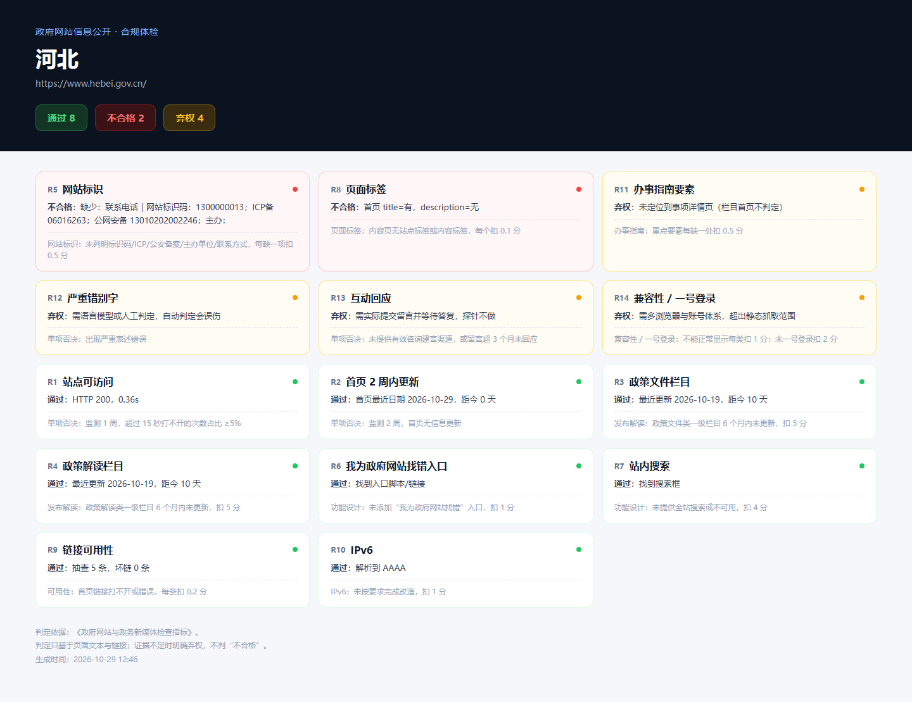
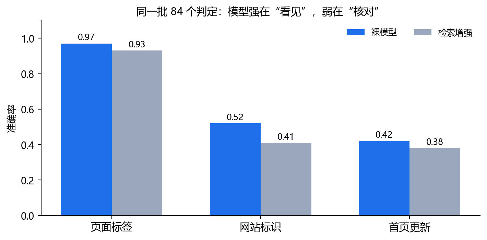

# 合规体检：一个会弃权的政务公开检查智能体

> 输入一个真实的政府网站，逐条对照《政府网站与政务新媒体检查指标》给出判定；
> 每条判定绑定页面证据；证据不足时明确弃权，不判"不合格"。

## 一个真实案例

河北省政府网站页脚：标识码、ICP 备案、公安备案、主办单位都在，**没有联系电话**。


系统对这个站点跑了 14 项检查：8 项通过、2 项不合格、4 项弃权。



另一项不合格是页面缺少 `meta description`——普通人看不见，但搜索引擎和读屏软件会读它。

## 模型能不能做这件事

同一批判定，给通用模型同样的页面文本（deepseek-flash，temperature=0）：

| 做法 | 准确率 | 弃权率 | 误报 |
|---|---|---|---|
| 裸模型（只给条款和页面） | 0.643 | 0.333 | 1 |
| 检索增强（给整份检查指标） | 0.583 | 0.405 | 1 |
| 本系统（规则 + 弃权） | 1.000* | 0 | 0 |

\* 本系统的准确率是构造出来的（真值由同一套规则定义），不算成绩；真正要比的是前两行的错。



模型强在"看见"（页面标签 0.97），弱在"核对"（五项标识 0.52）和"数日期"（0.42）。
检索增强反而更差：给整份标准没让它更准，只让它更犹豫。

## 快速开始

```powershell
cd 项目

# 1. 跑 30 个真实政府网站的 14 项检查
python tools/gov_audit_probe.py --sites-file data/gov-sites-30.json

# 2. 生成单文件体检报告
python tools/gov_report.py --site 河北
# 打开 submission/report-河北.html

# 3. 复现三基线对照（需要 DeepSeek API key）
set DS_KEY=sk-...
python tools/m1_baseline.py --judgments data/m1-judgments.json

# 4. 导出体检知识图谱（站点 → 判定 → 条款）
python tools/gov_kg.py --out data/gov-kg.json
```

## 它怎么做判定

- **渲染**：无头浏览器打开首页，保存 HTML 与可见文本；
- **抽取**：标题、`meta description`、正文、页脚窗口；
- **判定**：14 条规则逐条比对，证据片段随判定保存；
- **弃权**：页脚证据不足 3 项、或 HTML 里有但正文不可见，一律弃权。

全过程不调用模型，同一页面重复跑结果一致。

## 仓库结构

```
项目/
  tools/           体检探针、报告页、基线对照、图谱导出
  data/            30 站清单、420 条判定、基线结果、图谱
  src/evostd/      判据引擎（MCP 服务，36 个工具）
  src/standard/    条款编译器、硬锚点抽取
  skills/          5 个技能包
  docs/            说明与历史材料
```

## 边界

- 体检规则目前在 Python 规则层（`tools/gov_audit_probe.py`），**尚未注册为 MCP 工具**；36 个 MCP 工具是判据引擎，负责条款编译、校验、台账与进化；
- 只判"文本里能看到的证据"；脚本注入、图片里的信息会弃权；
- `项目/docs/` 下 2026-10 之前的材料是制造业版，保留作对照，不代表当前方向。

## 许可

Apache-2.0。数据来自公开政府网站，不含个人信息。
